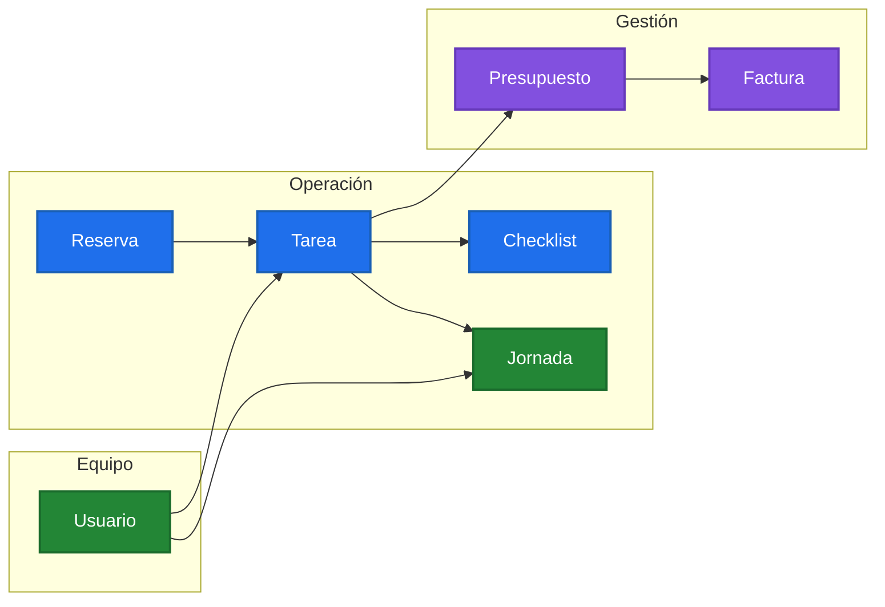
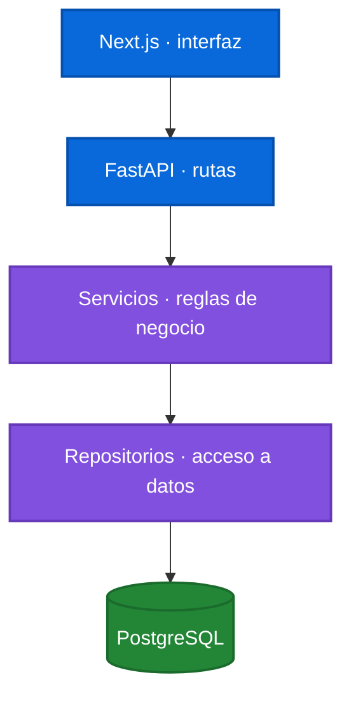

# WorkHive

> Operaciones de servicios, desde la reserva hasta la factura.

WorkHive reúne ubicaciones, reservas, tareas, equipos, jornadas, presupuestos
y facturas en un mismo espacio de trabajo.



## Todo el flujo, conectado

| Área | Qué permite |
| --- | --- |
| Operación | Clientes, ubicaciones, reservas y tareas en un solo lugar. |
| Equipo | Asignaciones, checklists, permisos y jornadas. |
| Negocio | Presupuestos, facturas, gastos y analítica. |
| Control | Datos y acciones aislados por empresa. |

## Principios del producto

- Una tarea tiene contexto: ubicación, cliente, responsables y estado.
- Cada empresa ve solo sus propios datos y operaciones autorizadas.
- El trabajo ejecutado puede convertirse en documentos comerciales sin duplicar datos.
- La interfaz y API comparten contratos de comportamiento para reglas críticas.

## Stack

- **Frontend:** Next.js + TypeScript
- **Backend:** FastAPI + Python
- **Datos:** PostgreSQL
- **Contenedores:** Docker Compose

## Estructura

```text
frontend/          Interfaz web y pruebas de frontend
backend/           API, dominio, persistencia y pruebas de backend
test_contracts/    Contratos compartidos que validan reglas backend/frontend
docker-compose.yml Servicios locales de la aplicación
```

## Arquitectura de código



Las rutas validan peticiones, los servicios aplican reglas y permisos, y los
repositorios concentran acceso a datos.

## Arranque local

Usa las plantillas `.env.example` de cada parte. Los valores reales viven solo
en tu entorno local o en el servidor.

```bash
docker compose up -d db

cd backend
python3.12 -m venv .venv
source .venv/bin/activate
pip install -r requirements-dev.txt
alembic upgrade head
uvicorn app.main:app --reload
```

En otra terminal:

```bash
cd frontend
corepack enable
pnpm install
pnpm dev
```

## Calidad

```bash
cd backend && ./.venv/bin/pytest -q

cd frontend && pnpm test && pnpm typecheck && pnpm lint
```

## Pruebas

- Backend: pruebas de API, permisos, aislamiento por empresa e integraciones.
- Frontend: pruebas unitarias de dominio, formularios, seguridad y utilidades.
- Contratos compartidos: validan reglas que deben coincidir en backend y frontend.
- E2E: escenarios de navegación críticos con Playwright.

## Seguridad

No se versionan contraseñas, tokens, certificados, claves privadas, backups ni
archivos de entorno reales.

## WIP

- Implementar el flujo de **Solicitar acceso**: debe avisar a
  `matheus@workhive.es`, pero no crear un usuario activo ni una empresa hasta
  que un administrador de WorkHive apruebe la solicitud.
