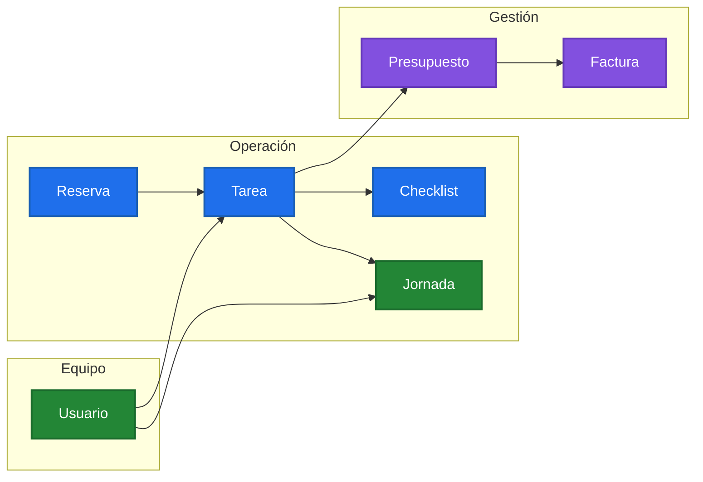
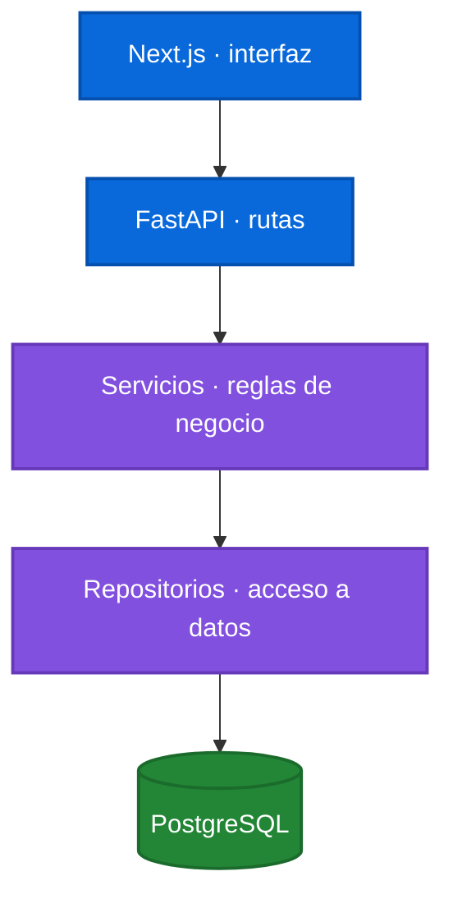

# WorkHive

[English](#english) · [Español](#español)

---

<a id="español"></a>

## Español

> Operaciones de servicios, desde la reserva hasta la factura.

WorkHive reúne ubicaciones, reservas, tareas, equipos, jornadas, presupuestos
y facturas en un mismo espacio de trabajo.



## Todo el flujo, conectado

| Área | Qué permite |
| --- | --- |
| Operación | Clientes, ubicaciones, reservas y tareas en un solo lugar. |
| Equipo | Asignaciones, checklists, permisos y jornadas. |
| Negocio | Presupuestos, facturas, gastos y analítica. |
| Control | Datos y acciones aislados por empresa. |

## Principios del producto

- Una tarea tiene contexto: ubicación, cliente, responsables y estado.
- Cada empresa ve solo sus propios datos y operaciones autorizadas.
- El trabajo ejecutado puede convertirse en documentos comerciales sin duplicar datos.
- La interfaz y API comparten contratos de comportamiento para reglas críticas.

## Stack

- **Frontend:** Next.js + TypeScript
- **Backend:** FastAPI + Python
- **Datos:** PostgreSQL
- **Contenedores:** Docker Compose

## Estructura

```text
frontend/          Interfaz web y pruebas de frontend
backend/           API, dominio, persistencia y pruebas de backend
test_contracts/    Contratos compartidos que validan reglas backend/frontend
docker-compose.yml Servicios locales de la aplicación
```

## Arquitectura de código



Las rutas validan peticiones, los servicios aplican reglas y permisos, y los
repositorios concentran acceso a datos.

## Arranque local

Clona el repositorio y crea los archivos de entorno solo para tu ordenador.
Git nunca copia `.env` reales, credenciales, datos de producción ni accesos AWS.

```bash
git clone https://github.com/limematheuz/workhive.git
cd workhive

# Si usas nvm, instala/activa la versión de Node fijada por el proyecto.
nvm install
nvm use

cp .env.example .env
cp backend/.env.example backend/.env
cp frontend/.env.example frontend/.env.local
```

Antes de arrancar, configura únicamente estos valores locales:

- En `.env`, elige un `POSTGRES_PASSWORD` local.
- En `backend/.env`, haz que `DATABASE_URL` use esa misma contraseña local.
- En `backend/.env`, sustituye `SECRET_KEY` por un valor local nuevo:

```bash
python3 -c "import secrets; print(secrets.token_hex(32))"
```

Email, Stripe, Google Calendar, VeriFactu, AWS, ECR, S3 y los valores de
producción son opcionales para desarrollo local. Sus funciones están
desactivadas por defecto en los archivos ejemplo. Nunca copies credenciales de
producción a la máquina de otra persona ni a un entorno de presentación.

Arranca una base PostgreSQL local vacía y aplica las mismas migraciones:

```bash
docker compose up -d db

cd backend
python3.12 -m venv .venv
source .venv/bin/activate
pip install -r requirements-dev.txt
alembic upgrade head
uvicorn app.main:app --reload
```

En otra terminal:

```bash
cd frontend
corepack enable
pnpm install --frozen-lockfile
pnpm dev
```

Cada desarrollador tiene una base de datos independiente. Para una presentación
usa datos demo ficticios; nunca compartas backups de producción ni datos de
clientes.

## Calidad

```bash
cd backend && ./.venv/bin/pytest -q

cd frontend && pnpm test && pnpm typecheck && pnpm lint

cd .. && pnpm test:architecture
```

Consulta las [guardas de arquitectura](docs/engineering/ARCHITECTURE_GUARDRAILS.md)
para las reglas que CI impone sobre tamaño y separación de capas.

## Pruebas

- Backend: pruebas de API, permisos, aislamiento por empresa e integraciones.
- Frontend: pruebas unitarias de dominio, formularios, seguridad y utilidades.
- Contratos compartidos: validan reglas que deben coincidir en backend y frontend.
- E2E: escenarios de navegación críticos con Playwright.

## Seguridad

No se versionan contraseñas, tokens, certificados, claves privadas, backups ni
archivos de entorno reales.

## Releases

Prepara una nueva versión desde una rama limpia:

```bash
pnpm release:prepare 1.3.3
pnpm release:verify
```

Después de mergear la PR de release, actualiza `main` y crea el tag anotado e
inmutable con un único comando seguro:

```bash
git switch main
git pull --ff-only origin main
pnpm release:tag
```

`release:tag` se niega a ejecutarse fuera de `main`, con cambios locales, si
`main` no coincide con GitHub o si el tag ya existe. Cada merge a `main` publica
las imágenes del SHA exacto y queda pendiente de aprobación en `production`
antes de desplegar. Las Actions **Publish release images to ECR** y **Deploy
reviewed release to production** se conservan para releases semánticas y
rollbacks deliberados. Consulta el documento de
[versionado de releases](docs/operations/RELEASE_VERSIONING.md) para el flujo
completo de producción y rollback.

## WIP

- Implementar el flujo de **Solicitar acceso**: debe avisar a
  `matheus@workhive.es`, pero no crear un usuario activo ni una empresa hasta
  que un administrador de WorkHive apruebe la solicitud.
- Pulir la UX/UI del envío de presupuestos tras la validación funcional en
  producción.

---

<a id="english"></a>

## English

> Service operations, from reservation to invoice.

WorkHive brings locations, reservations, tasks, teams, time tracking, quotes,
and invoices together in one workspace.

### Connected workflow

| Area | What it enables |
| --- | --- |
| Operations | Clients, locations, reservations, and tasks in one place. |
| Team | Assignments, checklists, permissions, and time tracking. |
| Business | Quotes, invoices, expenses, and analytics. |
| Control | Company-scoped data and actions. |

### Product principles

- A task has context: location, client, assignees, and status.
- Each company sees only its own authorized data and operations.
- Completed work can become commercial documents without duplicating data.
- UI and API share behavioural contracts for critical rules.

### Stack and repository structure

- **Frontend:** Next.js + TypeScript (`frontend/`)
- **Backend:** FastAPI + Python (`backend/`)
- **Data:** PostgreSQL
- **Containers:** Docker Compose (`docker-compose.yml`)
- **Shared contracts:** backend/frontend rules (`test_contracts/`)

Routes validate transport input, services enforce business rules and
permissions, and repositories centralize data access.

### Local development

Clone the repository and create local-only environment files. Git never copies
real `.env` files, credentials, production database data, or AWS access.

```bash
git clone https://github.com/limematheuz/workhive.git
cd workhive

# If you use nvm, install/use the Node line fixed by the repository.
nvm install
nvm use

cp .env.example .env
cp backend/.env.example backend/.env
cp frontend/.env.example frontend/.env.local
```

Set only these local values before starting:

- In `.env`, choose a local `POSTGRES_PASSWORD`.
- In `backend/.env`, make `DATABASE_URL` use that same local password.
- In `backend/.env`, replace `SECRET_KEY` with a newly generated local value:

```bash
python3 -c "import secrets; print(secrets.token_hex(32))"
```

Email, Stripe, Google Calendar, VeriFactu, AWS, ECR, S3, and production values
are optional for local development. Their features are disabled by default in
the example files. Never copy production credentials into another person's
machine or into a presentation environment.

Start an empty local PostgreSQL database and apply the same schema migrations:

```bash
docker compose up -d db

cd backend
python3.12 -m venv .venv
source .venv/bin/activate
pip install -r requirements-dev.txt
alembic upgrade head
uvicorn app.main:app --reload
```

In another terminal:

```bash
cd frontend
corepack enable
pnpm install --frozen-lockfile
pnpm dev
```

Each developer has an independent local database. Use fictional demo data for
presentations; do not distribute production backups or customer data.

### Quality checks

```bash
cd backend && ./.venv/bin/pytest -q

cd frontend && pnpm test && pnpm typecheck && pnpm lint

cd .. && pnpm test:architecture
```

See the [architecture guardrails](docs/engineering/ARCHITECTURE_GUARDRAILS.md)
for CI-enforced size and layer-boundary rules.

### Releases

Prepare a new release version from a clean branch:

```bash
pnpm release:prepare 1.3.3
pnpm release:verify
```

After the release PR is merged, update `main` and create the immutable
annotated tag with one safe command:

```bash
git switch main
git pull --ff-only origin main
pnpm release:tag
```

`release:tag` refuses to run from another branch, with uncommitted changes,
when `main` is out of sync with GitHub, or when the tag already exists. Every
merge to `main` publishes the exact SHA images and waits for `production`
approval before deploying. **Publish release images to ECR** and **Deploy
reviewed release to production** remain available for semantic releases and
deliberate rollbacks. See [release versioning](docs/operations/RELEASE_VERSIONING.md)
for the complete production flow and rollback procedure.

### Security

Passwords, tokens, certificates, private keys, backups, real environment files,
and customer data are never versioned.
