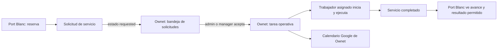

# WorkHive — guía de piloto y aceptación antes del primer cliente

**Versión mínima:** `v1.2.11`

**Entorno de ejecución:** producción: `https://app.workhive.es`
**Propósito:** validar WorkHive de punta a punta con dos empresas reales, pero
sin procesar todavía trabajo comercial crítico ni almacenar datos sensibles en
Git.

Esta guía sirve a tres personas:

- equipo de WorkHive que conduce la prueba;
- empresa emisora / inmobiliaria que registra reservas y solicita servicios;
- empresa receptora / prestadora que organiza y ejecuta el servicio.

No es una guía de desarrollo. Es guion de una prueba operativa real. Cada caso
tiene objetivo, pasos, resultado esperado, evidencia y decisión si falla.

> **Regla de privacidad:** los datos reales de empresas, propietarios,
> identificadores fiscales, direcciones, teléfonos, correos, enlaces de
> reserva, contraseñas, tokens y capturas con huéspedes se introducen **a mano
> en producción**. No se copian en este archivo, issues, PRs, commits ni chats
> públicos. La hoja de resultados se conserva en una carpeta privada del
> proyecto.

---

## 1. Qué resuelve WorkHive

WorkHive centraliza operación de servicios de campo para empresas como limpieza,
inmobiliarias y sus colaboradores:

1. Una empresa registra clientes, ubicaciones y servicios repetibles.
2. Planifica trabajo desde tareas manuales o desde una reserva.
3. Asigna un equipo y requisitos/checklist a cada trabajador.
4. El trabajador inicia, registra tiempo, responde requisitos y adjunta
   evidencias.
5. El responsable supervisa y completa el servicio.
6. La empresa emite presupuesto o factura, los envía por email y analiza
   ingresos, gastos y beneficio.
7. Una inmobiliaria patrocinada conserva sus propiedades y reservas; la
   prestadora decide cómo ejecutar el servicio. La inmobiliaria usa un portal
   limitado, no el dashboard completo de una empresa que paga WorkHive.

El límite principal es el tenant: cada empresa es un espacio aislado. Ver algo
en pantalla nunca sustituye la comprobación de permisos del servidor.

### Modelo operativo del piloto

| Papel | Empresa de prueba | Responsabilidad |
| --- | --- | --- |
| Receptora / prestadora | Ownet | Recibe solicitudes, asigna trabajadores, ejecuta y factura sus servicios. |
| Emisora / inmobiliaria | Port Blanc Costa Brava | Con portal patrocinado, gestiona sus propiedades y reservas y solicita limpieza; no usa Finanzas, Equipo ni el dashboard interno. |
| Plataforma | WorkHive | Supervisa empresas, pruebas, acceso global y alertas de caducidad. |

Las fichas fiscales y de contacto de ambas empresas se registran manualmente
desde sus fuentes verificadas. Antes de pulsar guardar, una segunda persona
debe comparar nombre legal, NIF/CIF, dirección fiscal, teléfono y email.

---

## 2. Reglas de esta prueba

1. Usar producción, cuentas reales de los socios y ubicaciones de prueba sin
   huéspedes activos cuando sea posible.
2. Crear un buzón de control privado para leer los emails recibidos. No usar
   una contraseña compartida ni reenviar enlaces de seguridad.
3. No activar `ALLOW_PUBLIC_REGISTRATION=true` para probar altas. El registro
   público actual crea un usuario activo y **no** implementa aprobación humana;
   por tanto permanece desactivado.
4. No cambiar secretos, SMTP, Google OAuth, base de datos ni variables de
   producción durante el piloto.
5. Cada prueba termina con una de estas marcas: `OK`, `FALLO`, `BLOQUEADO` o
   `NO APLICA`. Un `FALLO` debe incluir URL, hora, rol usado, pasos y captura
   sin datos de huéspedes.
6. Nunca usar una tarjeta real ni una reserva comercial para forzar un caso de
   error.

### Hoja privada de resultados

Crear una tabla privada con estas columnas antes de empezar:

| ID | Flujo | Operador / rol | Pasos ejecutados | Esperado | Resultado | Evidencia privada | Incidencia |
| --- | --- | --- | --- | --- | --- | --- | --- |
| P-01 | Alta empresas | Superadmin | … | … | Pendiente | — | — |

La evidencia debe contener ID interno o captura recortada. No incluir tokens,
cookies, claves, correo completo de huéspedes ni números de tarjeta.

---

## 3. Roles que se usarán

| Rol | Puede | No puede |
| --- | --- | --- |
| Superadmin WorkHive | Gestionar empresas, aprobar/rechazar solicitudes de prueba, ver administración global. | Ejecutar trabajo de una empresa sin pertenecer a ella. |
| Usuario de portal inmobiliaria | Consultar propiedades propias, crear reservas y seguir solicitudes enviadas a la prestadora anfitriona. | Acceder al dashboard completo, Finanzas, Equipo, precios, trabajadores o datos de otra colaboración. |
| Admin receptora | Aceptar/rechazar solicitudes, planificar, asignar, editar y facturar trabajo propio. | Cambiar la reserva original de la emisora. |
| Manager receptora | Aceptar solicitudes y coordinar tarea/equipo dentro de Ownet. | Administración global o fiscal de otra empresa. |
| Trabajador receptor | Ver tareas/requisitos asignados, iniciar trabajo, registrar tiempo y evidencias. | Aceptar una solicitud entre empresas, cambiar precio, facturar o ver datos privados de otra empresa. |
| Viewer | Consultar el alcance autorizado. | Crear, editar, aceptar, facturar o iniciar trabajo. |

**Decisión de producto vigente:** la aceptación de una solicitud entre empresas
la hace un `admin` o `manager` de la receptora. Un trabajador no la acepta:
solo recibe requisitos después de esa aceptación y los ejecuta. Esto evita que
un operario convierta unilateralmente una solicitud comercial en compromiso de
empresa.

### Cuentas mínimas

Crear e invitar, con emails distintos y controlados por socios:

1. Superadmin WorkHive.
2. Admin de Ownet.
3. Manager de Ownet.
4. Dos trabajadores de Ownet: trabajador A y trabajador B.
5. Una persona de Port Blanc Costa Brava que reciba el portal patrocinado.

No reutilizar la cuenta admin como trabajador. No compartir contraseñas.

---

## 4. Arquitectura de la colaboración emisor → receptora

### Respuesta exacta sobre Google Calendar

Una tarea creada por la inmobiliaria para la prestadora se guarda con la
empresa receptora como propietaria operativa. Por tanto:

- se sincroniza con el calendario `WorkHive - [empresa receptora]` conectado
  por su admin;
- **no** se crea una copia de esa tarea en el calendario Google de la emisora;
- la emisora conserva la reserva en WorkHive y ve las notificaciones/estado
  permitidos dentro de WorkHive;
- asignar un trabajador no crea calendarios personales independientes: hoy hay
  un calendario Google conectado por empresa y las asignaciones se reflejan en
  el contenido del evento.

Esto es correcto para el modelo actual: una tarea operativa pertenece a quien
la ejecuta. Evita duplicados y evita que la emisora controle el calendario
operativo de Ownet.

### Futuro: reservas y pagos desde WorkHive

La web de Port Blanc usa un motor de reservas externo. WorkHive **no** debe
leerlo mediante scraping ni copiar tarjetas/pagos. Para traer reservas y pagos
de forma segura hacen falta, antes de activar esa promesa comercial:

1. contrato/autorización de Port Blanc y del proveedor del motor;
2. API o webhook oficial con autenticación, eventos firmados e idempotencia;
3. mapeo explícito de propiedad, reserva, huésped y estado de cancelación;
4. minimización de datos: Ownet solo recibe lo necesario para ejecutar;
5. conciliación de cambios, reintentos, auditoría y proceso de borrado RGPD;
6. integración de pagos por proveedor certificado. WorkHive nunca almacena
   números de tarjeta.

Hasta entonces, la inmobiliaria crea/edita manualmente sus reservas dentro de
WorkHive y elige la prestadora. Ver [§ 17](#17-pendientes-y-límites-conocidos).

---

## 5. Estados de tareas: lenguaje común

| Estado | Significa | Quién lo produce |
| --- | --- | --- |
| `pending` / Pendiente | Trabajo interno creado, aún no iniciado. | Admin/manager al crear. |
| `requested` / Solicitud pendiente | Servicio enviado por empresa emisora; la receptora aún no lo aceptó. | Reserva/solicitud externa. |
| `accepted` / Aceptada | Receptora aceptó y puede distribuir trabajo. | Admin/manager receptora. |
| `progress` / En progreso | Un trabajador inició trabajo. | Trabajador asignado. |
| `review` / En revisión | Revisión operativa cuando se use. | Admin/manager. |
| `completed` / Completada | Checklist obligatorio resuelto y trabajo cerrado. | Flujo de checklist/admin. |
| `rejected` / Rechazada | Receptora rechazó la solicitud. | Admin/manager receptora. |

No mover una tarea a completada si quedan requisitos obligatorios. Una tarea ya
facturada queda inmutable para proteger trazabilidad.

---

## 6. Fase 0 — comprobación de plataforma

### Objetivo

Confirmar que la versión, permisos y servicios necesarios existen antes de
crear datos de prueba.

### Pasos

1. Abrir `https://app.workhive.es/health` sin compartir el resultado que
   contenga datos internos; comprobar versión `1.2.11` o posterior.
2. Iniciar sesión como superadmin y comprobar que se ven Empresas, Roles,
   Integraciones y solicitudes de prueba.
3. Iniciar sesión como admin de Ownet y comprobar que se ven Tareas,
   Ubicaciones, Clientes, Reservas, Facturación, Gastos y Calendario según su
   rol.
4. Abrir una ventana privada sin sesión. Intentar abrir una URL de dashboard.
5. Comprobar envío de un email no crítico: usar recuperación de contraseña de
   una cuenta de prueba ya existente y no completar el cambio todavía.

### Esperado

- acceso autenticado redirige a login cuando no hay sesión;
- cada usuario ve su menú correcto;
- el email de recuperación llega desde el remitente profesional configurado;
- ningún email muestra contraseñas, secretos o datos de otra empresa.

### Evidencia

Versión, rol, resultado de login y encabezados del email. No guardar token de
recuperación en la hoja.

---

## 7. Fase 1 — empresas, datos fiscales y onboarding

### Objetivo

Dejar una receptora (Ownet) y una emisora (Port Blanc Costa Brava) con datos
correctos, sin mezclar propiedad de ubicaciones ni facturación.

### Pasos

1. Como superadmin, abrir **Empresas**.
2. Verificar Ownet ya existente. Comparar manualmente su ficha con la fuente
   fiscal aprobada por sus socios. Corregir solo si hay un error confirmado.
3. Crear Port Blanc Costa Brava como empresa independiente. Introducir sus
   datos legales manualmente; validar email y teléfono antes de guardar.
4. Crear el admin de Port Blanc mediante flujo de provisión/invitación.
5. Abrir el enlace recibido en una sesión privada, fijar contraseña y completar
   onboarding como modelo `property_manager` o el modelo real acordado.
6. Cerrar sesión, volver a entrar y verificar que el onboarding no reaparece.
7. Como admin de Ownet, intentar buscar la empresa Port Blanc fuera del área de
   colaboración. Como admin de Port Blanc, hacer lo mismo con Ownet.

### Esperado

- cada empresa tiene ID y código de colaboración distintos;
- Ownet y Port Blanc no comparten clientes, ubicaciones, facturas ni emails
  guardados;
- solo superadmin puede alterar el estado global de empresa;
- las dos tentativas de acceso cruzado fallan o no listan datos.

### Si falla

Detener el piloto. No continuar con reservas ni facturación hasta resolver
aislamiento de tenant.

---

## 8. Fase 2 — clientes, ubicaciones y catálogo de servicios

### Objetivo

Crear base comercial y operativa antes de producir tareas.

### Pasos

1. Como admin de Ownet, abrir **Facturación → Clientes** y crear un cliente de
   prueba con datos de contacto propios, no de un huésped.
2. Crear una ubicación de servicio interna de Ownet. Elegir nombre claro,
   dirección y tipo correctos.
3. Abrir **Tareas → Plantillas** y crear servicios reutilizables, por ejemplo
   limpieza de cambio, limpieza profunda y revisión final. Añadir precio base,
   unidad y checklist.
4. Desde la ubicación, vincular los servicios que aplican a ese local.
5. Editar cliente, ubicación y plantilla; cancelar otra edición sin guardar.
6. Como Port Blanc, crear una ubicación inmobiliaria propia. No crear todavía
   reserva comercial.

### Esperado

- cancelar no persiste cambios;
- una tarea interna de Ownet puede existir sin huésped;
- la empresa receptora no ve contexto de reservas al crear una tarea manual si
  no tiene permiso de gestionar reservas de esa ubicación;
- Port Blanc es propietaria/gestora de su ubicación; Ownet solo obtiene acceso
  cuando se cree la colaboración.

---

## 9. Fase 3 — formularios de tarea: prueba de UX

### Objetivo

Comprobar que crear y editar expresan mismo modelo mental:
**planificación → servicio/checklist → notas/importe → estado**.

### Crear tarea interna

1. Como admin de Ownet, abrir **Tareas → Nueva tarea**.
2. Elegir ubicación interna y fecha.
3. Confirmar responsable del calendario. No confundirlo con trabajador: los
   trabajadores se asignan en los requisitos/checklist.
4. Seleccionar uno o más servicios fijos, expandir pasos y asignar uno a
   trabajador A, otro a trabajador B y uno a todo el equipo si aplica.
5. Guardar.
6. Verificar tarjeta en columna **Pendientes**. Abrirla y editar título, fecha,
   checklist, notas e importe. Guardar y recargar.

### Editar tarea existente

1. Abrir la misma tarjeta desde tablero, lista y calendario interno.
2. Confirmar que cada entrada abre mismo modal y mismos datos.
3. Cambiar solo una nota interna; guardar y comprobarla.
4. Cancelar un cambio de título antes de guardar; recargar y confirmar que no
   se persistió.
5. Intentar completar con un requisito obligatorio pendiente.

### Esperado

- crear y editar usan secciones, controles y acciones visualmente coherentes;
- no hay dos campos de reserva para una tarea interna de Ownet;
- título, fecha, checklist, notas, precio/unidad y estado muestran etiquetas
  claras;
- tarea nueva queda `pending`, no `progress`;
- admin puede abrir/editar tarjeta;
- completar con checklist pendiente se bloquea.

### Móvil

1. Repetir crear, abrir y editar desde Safari/Chrome móvil.
2. Hacer scroll vertical con un gesto en cada modal.
3. Abrir una tarea asignada como trabajador.

**Esperado:** el botón **Empezar tarea** permanece flotante junto al borde
inferior; no hay scroll bloqueado ni doble gesto necesario; pie de acciones no
oculta campos ni botones.

---

## 10. Fase 4 — ejecución, fichajes y reportes de campo

### Objetivo

Confirmar que trabajadores solo ejecutan trabajo asignado, que el tiempo queda
atribuido a la empresa correcta y que fotos/notas/incidencias forman evidencia
operativa sin exponer datos de otra empresa.

### Pasos

1. Como admin de Ownet, confirmar que una tarea aceptada tiene al menos un
   requisito asignado a trabajador A y otro a trabajador B.
2. Como trabajador A, abrir su tarea desde **Tareas** en móvil. Pulsar
   **Iniciar jornada / Empezar tarea** y permitir ubicación precisa solo para
   este caso de prueba autorizado.
3. Añadir una nota y una foto de prueba que no muestre huésped, documento,
   matrícula ni dirección privada. Completar únicamente su requisito.
4. Como admin/manager Ownet, abrir **Fichajes en vivo**. Buscar trabajador A,
   abrir la tarea y verificar hora, empresa, ubicación y contador. Probar
   filtros de equipo propio/colaborador si aplica.
5. Como trabajador A, pausar/reanudar si aparece esa acción, y terminar la
   jornada. Si quedan requisitos asignados en esa ubicación, verificar aviso
   antes de confirmar salida.
6. Como admin, abrir **Reportes de campo**. Filtrar nota, foto e incidencia;
   abrir detalle y verificar tarea vinculada, autor y hora. Probar editar y
   borrar solo un reporte de prueba autorizado.
7. Como trabajador B y como usuario de Port Blanc, repetir apertura de la
   misma tarea/reporte para comprobar qué puede ver cada rol.

### Esperado

- trabajador no inicia tarea ajena ni una solicitud aún no aceptada;
- un fichaje activo aparece a responsables autorizados y desaparece al salir;
- tiempo, foto, nota e incidencia pertenecen a Ownet y a tarea concreta;
- Port Blanc recibe únicamente visibilidad permitida del servicio externo, no
  fotos, coste interno, sesiones ni reportes privados de Ownet;
- cancelar tarea activa detiene jornada y deja aviso claro;
- borrar evidencia de prueba elimina solo esa evidencia y respeta permisos.

---

## 11. Fase 5 — colaboración, reservas y servicio externo

### Objetivo

Probar relación Port Blanc (emite) → Ownet (recibe) sin exponer más datos de
reserva de los necesarios.

### A. Crear colaboración

1. Usar una colaboración inmobiliaria → Ownet ya aceptada. La alta de una
   inmobiliaria patrocinada nueva todavía es un proceso controlado por
   WorkHive; no usar la invitación B2B histórica, porque exige tenant de pago.
2. Como admin de Ownet, abrir **Colaboraciones**, localizar la inmobiliaria y
   pulsar **Gestionar portal**.
3. Elegir explícitamente la persona de Port Blanc y activar el portal.
4. Cerrar su sesión e iniciar sesión de nuevo. Debe llegar a
   **Portal de colaboradores**, no al dashboard completo.

**Esperado:** el grant queda ligado a esa colaboración y a Ownet; Port Blanc
no puede elegir otro proveedor ni acceder a Finanzas, Equipo o datos internos.

### B. Crear reserva y solicitud

1. Como usuario de portal de Port Blanc, abrir **Solicitudes** y crear una
   reserva de prueba futura para una propiedad propia existente.
2. Indicar salida, entrada posterior, número de huéspedes mínimo ficticio y
   guardar. Ownet es la prestadora fija: el portal no permite seleccionar otra.
3. Guardar. Si hay segunda reserva consecutiva, crearla para probar límite de
   entrada.
4. Iniciar sesión como admin/manager de Ownet y abrir **Reservas → Solicitudes**.

**Esperado:**

- Ownet recibe una solicitud `requested`, nunca aceptada de forma automática;
- se muestra fecha de salida, ventana hasta próxima entrada y contexto
  operativo autorizado;
- no se revela contacto de huésped, datos de pago ni información ajena;
- Port Blanc solo ve el estado autorizado de su solicitud, no la operación
  interna de Ownet.

### C. Aceptar y ejecutar

1. Como admin o manager de Ownet, abrir solicitud.
2. Elegir hora dentro de ventana: nunca antes de salida ni después de entrada.
3. Aceptar. La solicitud pasa a `accepted`.
4. Asignar checklist a trabajadores A/B.
5. Iniciar sesión como trabajador A. Abrir tarea propia, iniciar trabajo con
   ubicación real o la ubicación de prueba autorizada, completar su requisito,
   añadir foto/nota de prueba sin huéspedes.
6. Repetir con trabajador B.
7. Como admin Ownet, completar trabajo cuando todos requisitos estén hechos.
8. Como Port Blanc, comprobar solicitud aceptada, inicio y completado.

**Esperado:**

- solo admin/manager acepta; trabajadores ejecutan después;
- sistema impide planificar fuera de la ventana de reserva;
- trabajador ve únicamente trabajo asignado;
- Ownet puede conservar evidencias operativas;
- Port Blanc ve estado pero no coste interno, usuarios no necesarios ni emails
  guardados de Ownet;
- rechazar otra solicitud de prueba genera estado `rejected` y aviso interno a
  Port Blanc.

### D. Pruebas negativas obligatorias

1. Como trabajador, intentar aceptar/rechazar solicitud externa.
2. Como Port Blanc, intentar cambiar título, precio o checklist operativo de la
   tarea después de enviarla.
3. Como Ownet, intentar editar reserva fuente de Port Blanc.
4. Usar URL/ID de la tarea con sesión de empresa no participante.

**Esperado:** `403`, `404`, botón ausente o datos no visibles. Cualquier dato
cruzado es fallo crítico de aislamiento.

---

## 12. Fase 6 — Google Calendar

### Objetivo

Validar sincronización empresa por empresa, sin duplicados ni fugas entre
Port Blanc y Ownet.

### Preparación

1. Como admin de Ownet, abrir **Calendario** e iniciar conexión Google solo si
   tiene permiso sobre la cuenta Google de Ownet.
2. Autorizar el calendario `WorkHive - Ownet` creado por WorkHive.
3. No conectar la cuenta Google de Port Blanc sin autorización expresa de Port
   Blanc. Si la conecta, debe hacerlo su propio admin desde su propia sesión.

### Casos

| ID | Acción | Resultado esperado |
| --- | --- | --- |
| CAL-01 | Crear tarea interna de Ownet con fecha. | Evento en `WorkHive - Ownet`. |
| CAL-02 | Editar fecha/título de esa tarea en WorkHive. | Mismo evento se actualiza; no duplica. |
| CAL-03 | Crear evento de prueba en calendario Google conectado de Ownet. | Se importa como tarea de Ownet en ubicación `General / Google Calendar` si aún no está enlazado. |
| CAL-04 | Crear reserva Port Blanc → Ownet y aceptar. | Evento de la tarea operativa solo en calendario WorkHive de Ownet. |
| CAL-05 | Buscar CAL-04 en Google Calendar de Port Blanc, si está conectado. | No existe una copia de tarea operativa. |
| CAL-06 | Cambiar fecha de tarea desde Google de Ownet. | WorkHive actualiza fecha de esa tarea enlazada. |
| CAL-07 | Desconectar Google de Ownet. | Se eliminan mapeos WorkHive/Google; no se borran tareas de WorkHive. |

### Criterio

Debe existir un único evento por combinación de tarea, empresa y calendario
conectado. Si aparece el mismo servicio en ambas empresas, detener prueba y
registrar IDs de evento/tarea sin incluir invitados de Google.

---

## 13. Fase 7 — presupuestos, facturas y finanzas

### Qué significa cada documento

| Documento | Uso | Efecto actual |
| --- | --- | --- |
| Presupuesto | Oferta comercial antes de realizar/cobrar. | Se crea, edita, previsualiza/descarga, marca enviado/aceptado y se envía por email. |
| Tarea completada | Evidencia de servicio realizado. | Puede convertirse en línea facturable de la empresa que ejecutó. |
| Factura | Documento de cobro. | Se crea como borrador, se emite/actualiza según permisos, PDF y envío por email. |
| Gasto | Coste interno. | Afecta gastos, IVA y beneficio en finanzas/analytics. |

### Flujo de presupuesto

1. Como admin Ownet, crear cliente de prueba propio.
2. Abrir **Facturación → Presupuestos → Nuevo presupuesto**.
3. Añadir título, cliente, líneas, cantidad, precio, IVA, notas, condiciones y
   validez.
4. Guardar en borrador. Abrir desde número y desde fila de listado.
5. Editar; confirmar que ambos accesos muestran mismo detalle.
6. Enviar a email de control de Ownet. Comprobar PDF, asunto y destinatarios.
7. Marcar enviado. Si el acuerdo existe, marcar aceptado.

### Flujo de factura

1. Completar una tarea interna de Ownet o crear línea manual de prueba.
2. Abrir **Facturación → Facturas → Nueva factura**.
3. Seleccionar cliente, tareas terminadas/líneas, IVA, fecha, vencimiento y
   datos del emisor. Revisar subtotal, base, IVA y total.
4. Guardar borrador. Abrir detalle, previsualizar y descargar PDF.
5. Enviar a email de control de Ownet; después marcar emitida/pagada solo como
   prueba si el documento no se usará comercialmente.
6. Abrir Port Blanc y confirmar que no aparecen los emails recordados, clientes
   o facturas de Ownet.

### Esperado

- presupuesto y factura usan datos fiscales de empresa activa;
- el formulario de email conserva destinatarios por empresa, nunca por navegador
  compartido entre tenants;
- PDF coincide con líneas e impuestos mostrados;
- una tarea facturada no se puede editar ni borrar;
- ningún usuario de Port Blanc puede facturar trabajo de Ownet salvo que Ownet
  lo facture dentro de su propia empresa.

### Gastos y beneficio

1. Registrar dos gastos de Ownet con categorías, fechas e IVA distintos.
2. Revisar **Finanzas/Analytics** por período.
3. Editar/anular uno y confirmar recálculo.
4. Como Port Blanc, repetir con gasto propio.

**Esperado:** ingresos, gastos, IVA y beneficio se calculan dentro de cada
empresa. No hay mezcla entre ambas.

---

## 14. Fase 8 — invitaciones, acceso y emails

### Invitación de trabajador

1. Como admin Ownet, invitar trabajador A con rol worker/viewer operativo.
2. Revisar email: empresa, rol, enlace/código, caducidad y remitente.
3. Abrir enlace una vez en sesión privada, introducir código y fijar contraseña.
4. Intentar reutilizar enlace/código y probar varios códigos erróneos.
5. Iniciar sesión como trabajador y confirmar alcance de tareas.

### Recuperación y cambio de email

1. Solicitar recuperación para cuenta de prueba existente y para email
   inexistente.
2. Completar recuperación de cuenta existente una sola vez.
3. Solicitar cambio de email con nueva dirección de control. Confirmar desde
   nueva bandeja.
4. Repetir token de confirmación o usarlo caducado.

### Matriz de emails actuales

| Evento | Destinatario | Existe hoy | Comprobar |
| --- | --- | --- | --- |
| Invitación trabajador | Trabajador | Sí | Código/enlace único, empresa y rol correctos. |
| Recuperación | Usuario existente | Sí | No revela si otro email existe; token no visible fuera del enlace. |
| Cambio email | Nueva dirección/usuario | Sí | Confirmación única y segura. |
| Presupuesto | Cliente indicado | Sí | PDF/datos de empresa emisora correctos. |
| Factura | Cliente indicado | Sí | PDF/importe/destinatarios correctos. |
| Solicitud de prueba | Solicitante | Sí | Verificación antes de crear empresa. |
| Aprobación de prueba | Admin nuevo | Sí | Enlace para fijar contraseña, fecha de fin si aplica. |
| Aviso 3 días de prueba | Admin de empresa + superadmin | Sí | Un solo aviso por empresa. |
| Solicitud pública de cuenta | Buzón WorkHive | No probar: registro público desactivado. | Pendiente de flujo seguro de aprobación. |
| Solicitud/aceptación/inicio/completado de tarea externa | Usuarios implicados | Notificación **in-app**, no email. | Ver campana/panel de notificaciones. |

Todos los emails transaccionales implementados usan plantilla visual común de
WorkHive y texto plano alternativo. Si alguno se ve diferente, guardar captura
privada y abrir incidencia.

---

## 15. Fase 9 — solicitud de prueba y caducidad

### Objetivo

Verificar que una prueba no crea acceso antes de aprobación y que expira de
verdad.

### Pasos

1. Desde contacto/solicitud de prueba, usar email nuevo controlado por el
   equipo. No usar email de cliente real.
2. Confirmar email de verificación dentro de 24 horas.
3. Como superadmin, abrir solicitudes de prueba, revisar datos y aprobar una
   prueba de 4 días para empresa desechable.
4. Confirmar email de aprobación, fijar contraseña, iniciar sesión y completar
   onboarding mínimo.
5. Confirmar fecha y hora de fin mostrada para la empresa.
6. Para probar aviso inmediatamente, como superadmin editar **solo la empresa
   desechable** y fijar fin de prueba a tres días calendario desde hoy. Esperar
   hasta una hora desde el siguiente arranque/revisión del servicio y revisar
   email de admin de empresa y superadmin.
7. Confirmar que llega una vez. Recargar y esperar siguiente revisión: no debe
   duplicarse.
8. Para caducidad, ajustar solo esa empresa desechable a fecha pasada desde UI
   de superadmin. Cerrar sesión, iniciar y llamar a una pantalla protegida.

### Esperado

- solicitud sin verificar no crea compañía ni usuario;
- solo superadmin aprueba/rechaza;
- aprobación crea empresa, admin y enlace de contraseña;
- aviso se envía una vez, tres días antes, al admin activo y superadmin activo;
- prueba vencida recibe bloqueo de acceso de sus usuarios no-superadmin;
- ninguna otra empresa se bloquea ni recibe correo por error.

### Importante

El formulario de prueba es distinto del registro público. Mantener registro
público desactivado. El flujo de “Solicitar acceso” con aprobación humana real
sigue pendiente; ver § 17.

---

## 16. Seguridad, aislamiento y casos de error

Ejecutar estos casos al menos una vez por rol. No realizar ataques de carga ni
escaneos agresivos contra producción.

| ID | Acción | Esperado |
| --- | --- | --- |
| SEC-01 | Cambiar ID de cliente, factura, tarea, reserva, gasto o media en URL/API desde otra empresa. | `403`/`404` o ausencia de datos. |
| SEC-02 | Abrir link de invitación, recuperación o cambio de email dos veces. | Segundo uso denegado/invalidado. |
| SEC-03 | Fallar login repetidamente con cuenta de prueba. | Rate limit tras límite configurado; no bloquear cuentas reales. |
| SEC-04 | Enviar formulario con HTML/script como título o nota. | Se trata como texto; no ejecuta script al verlo. |
| SEC-05 | Subir archivo de prueba permitido y tipo no permitido/excesivo. | Permitido funciona; no permitido es rechazado. |
| SEC-06 | Añadir email de factura/presupuesto en Ownet y abrir Port Blanc. | Port Blanc no lo ve ni lo autocompleta. |
| SEC-07 | Trabajador A abrir tarea de B. | No puede iniciar ni mutar alcance ajeno. |
| SEC-08 | Emisora intentar alterar ejecución externa. | Solo ve seguimiento permitido. |
| SEC-09 | Receptora intentar editar reserva fuente. | Denegado. |
| SEC-10 | Enviar reserva/solicitud repetida o superpuesta. | Duplicado/solape se controla y no duplica servicio. |

Los rate limits actuales son locales a proceso. Mitigan abuso básico de formulario
pero no sustituyen WAF/CDN ante DDoS distribuido. No se debe publicar una promesa
de protección volumétrica hasta activar capa externa.

---

## 17. Pendientes y límites conocidos

| Prioridad | Pendiente / límite | Estado actual | Decisión antes de venta |
| --- | --- | --- | --- |
| P0 | WAF/CDN/balanceador con rate limiting y protección DDoS | No contratado; limitador es local por proceso. | Mantener WIP y no prometer mitigación DDoS volumétrica. |
| P0 | “Solicitar acceso” público con revisión humana | Registro público queda desactivado porque no crea solicitud pendiente. | Implementar entidad solicitud, aviso a WorkHive, revisión, invitación y auditoría antes de abrir registro. |
| P1 | Integración oficial Port Blanc / motor de reservas | Reserva manual en WorkHive; no API/webhook del motor externo. | Requiere contrato, API/webhook oficial, RGPD, idempotencia y pruebas. |
| P1 | Pagos de huéspedes/reservas | No existe integración de pago del motor externo. | Usar proveedor de pagos certificado; no almacenar tarjeta. |
| P1 | Emails de ciclo de tarea externa | Hoy son notificaciones dentro de WorkHive, no emails. | Decidir si socios necesitan email; implementar preferencias, anti-duplicado y tests. |
| P1 | Calendario individual de cada trabajador | Un calendario Google conectado por empresa. | Diseñar consentimiento, múltiples conexiones y reglas de visibilidad antes de ampliar. |
| P1 | VeriFactu / Facturae | Variables y almacenamiento preparados, integración desactivada. | No activar hasta certificado real, revisión fiscal/legal y pruebas de entorno oficial. |
| P2 | Pagos/subscripciones Stripe | Desactivados. | Activar solo con productos, webhooks, conciliación y soporte definidos. |
| P2 | Almacenamiento de medios en S3 | Producción usa almacenamiento local para medios. Backups usan bucket separado. | Evaluar S3 antes de crecer en fotos/evidencias. |
| P2 | UX comercial de presupuesto | Envío funciona; quedan mejoras visuales. | WIP, no bloquea piloto controlado. |

Un pendiente no se considera hecho por aparecer en pantalla: debe tener caso de
aceptación, autorización, prueba automatizada y decisión de despliegue.

---

## 18. Criterio de salida del piloto

Se puede avanzar a primer cliente pagador solo cuando:

1. Todas las filas P-01… de la hoja privada están `OK` o tienen excepción
   comercial aprobada por socios.
2. No existe fallo crítico de tenant, autorización, factura, email o reserva.
3. Ownet y Port Blanc han validado por escrito los límites de calendario,
   reservas y pagos descritos arriba.
4. Se recibió y revisó cada email implementado.
5. La empresa de prueba vencida quedó realmente bloqueada y el aviso de tres
   días no se duplicó.
6. Backups, salud de producción y procedimiento de rollback se revisaron.
7. Pendientes P0 tienen dueño y fecha o se han aceptado explícitamente como
   riesgo de piloto.

Si un caso falla, parar solo el flujo afectado, conservar evidencia privada y
abrir incidencia. No “compensar” un fallo de permisos creando una excepción
manual para un cliente.
