# Guía de entrega de producción

Esta guía explica, desde cero y sin secretos, cómo WorkHive convierte código
revisado en una versión ejecutándose en producción. Es el documento de referencia
para una persona nueva en el proyecto o para un agente que deba ayudar con la
operación.

Los ejemplos usan nombres entre `<...>`. Nunca se deben sustituir por valores
reales dentro de Git, de un pull request, una incidencia pública o un chat.
Las credenciales, identificadores de infraestructura y ficheros de entorno
reales viven solamente en AWS, en el host de producción o en el gestor de
contraseñas aprobado.

## Objetivo y resultado

El flujo de producción está diseñado para que el servidor **descargue imágenes
ya construidas**. EC2 no compila el frontend ni el backend durante un despliegue.
Eso reduce uso de CPU, memoria, disco y el riesgo de que una compilación larga
deje el servidor sin recursos.

```mermaid
flowchart LR
    DEV["Cambio revisado\nen una PR"] --> CI["CI, pruebas\ny controles de seguridad"]
    CI --> MAIN["Merge a main"]
    MAIN --> TAG["Tag anotado\nvMAJOR.MINOR.PATCH"]
    TAG --> BUILD["GitHub Actions\nconstruye imágenes"]
    BUILD --> ECR["ECR privado\nimágenes inmutables"]
    ECR --> DEPLOY["GitHub OIDC + SSM\nordena el despliegue"]
    DEPLOY --> EC2["EC2 descarga, migra\ny verifica salud"]
    EC2 --> BACKUP["Backup previo\ny rollback si falla"]
```



Cada flecha tiene una responsabilidad distinta. Separarlas evita que una sola
credencial pueda modificar código, publicar imágenes y ejecutar comandos
arbitrarios en producción.

## Glosario

| Término | Significado práctico |
| --- | --- |
| **AWS** | Amazon Web Services, la plataforma cloud que alberga infraestructura de WorkHive. |
| **EC2** | Máquina virtual de AWS. Es el servidor que ejecuta Caddy, frontend, backend y PostgreSQL mediante Docker Compose. |
| **ECR** | Elastic Container Registry. Registro privado de AWS donde se guardan imágenes Docker del backend y frontend. |
| **Imagen Docker** | Paquete inmutable que contiene una aplicación y sus dependencias. Un contenedor es una instancia en ejecución de esa imagen. |
| **Tag de imagen** | Etiqueta de una imagen, por ejemplo `v1.2.3` o un SHA. En ECR es inmutable: no se puede sobrescribir. |
| **Git tag** | Referencia de Git a un commit concreto. Un tag anotado guarda también autor, fecha y mensaje de la release. |
| **SemVer** | Versionado semántico `MAJOR.MINOR.PATCH`: incompatible, nueva funcionalidad compatible y corrección compatible. |
| **SHA / Git SHA** | Identificador criptográfico de un commit. Indica exactamente qué código se construyó. No es una contraseña. |
| **CI** | Integración continua: pruebas y verificaciones automáticas ejecutadas por GitHub Actions. |
| **GitHub Actions** | Automatización alojada en GitHub. En este proyecto ejecuta CI, publica imágenes tras llegar a `main` y solicita despliegues aprobados. |
| **IAM** | Identity and Access Management. Sistema de permisos de AWS. |
| **Role / rol IAM** | Identidad de AWS con permisos, usada temporalmente por EC2 o GitHub Actions. No contiene una contraseña fija. |
| **OIDC** | OpenID Connect. GitHub demuestra su identidad ante AWS y recibe credenciales temporales; no se guardan claves AWS en GitHub. |
| **SSM** | AWS Systems Manager. Permite solicitar una operación controlada en EC2 sin abrir SSH a GitHub. |
| **Documento SSM** | Receta privada y versionada de SSM que acepta parámetros validados y ejecuta un único script aprobado en EC2. |
| **S3** | Almacenamiento de objetos de AWS. Conserva copias de seguridad privadas fuera de EC2. |
| **SSE-S3** | Cifrado del lado del servidor administrado por S3. Cifra objetos almacenados sin gestionar una clave KMS propia. |
| **Instance profile** | Mecanismo que asocia un rol IAM a EC2 para que el host reciba credenciales temporales desde AWS. |
| **IMDS** | Instance Metadata Service. Servicio local de EC2 que entrega esas credenciales temporales al rol de la instancia. |
| **Alembic** | Herramienta de migraciones de PostgreSQL del backend. Aplica cambios de esquema hacia delante. |
| **Health check** | Comprobación automática de que un servicio responde correctamente antes de declararlo listo. |
| **Rollback** | Vuelta controlada a una imagen de release anterior que ya fue publicada y conservada en ECR. |

## Qué permanece fuera de Git

Estos elementos son necesarios en producción, pero no son código versionable:

- archivo de entorno real de Compose, por ejemplo `<APP_DIRECTORY>/.env`;
- configuración privada de backup y despliegue bajo `/etc/<APP_NAME>/`;
- contraseñas de PostgreSQL, correo y proveedores externos;
- claves privadas SSH, tokens, cookies y certificados;
- IDs de cuenta, IPs públicas, nombres reales de buckets y ARNs de producción;
- datos de clientes, archivos subidos y copias de seguridad.

Las plantillas terminadas en `.example`, los scripts sin valores reales y la
documentación con placeholders sí pueden estar en Git.

## Componentes y límites de permisos

### GitHub Actions de calidad

Al abrir o actualizar una pull request, GitHub ejecuta automáticamente CI,
seguridad y comprobaciones de frontend. Estas acciones **no despliegan** nada.
Su función es impedir que código no revisado llegue a `main`.

### Publicación de imágenes

Cada push a `main` —normalmente el resultado de mergear una PR revisada— activa
**Deploy main to production**. Primero espera CI, seguridad y React Doctor del
SHA exacto; después publica las imágenes backend/frontend con ese SHA inmutable
y queda detenido hasta que un revisor apruebe el entorno GitHub `production`.
Solo entonces solicita el despliegue por OIDC y SSM. Las PR no publican ni
despliegan imágenes.

La acción manual **Publish release images to ECR** usa un rol OIDC dedicado que
puede publicar únicamente en los repositorios ECR de WorkHive. Ese rol no debe
tener permiso para ejecutar comandos en EC2.

La acción verifica, antes de construir:

1. el formato estricto del tag `vMAJOR.MINOR.PATCH`;
2. que el tag Git es anotado;
3. que el commit etiquetado pertenece a `main`;
4. que `VERSION` coincide con el tag solicitado;
5. que las comprobaciones obligatorias de CI y seguridad pasaron en ese commit;
6. que los tags de imagen todavía no existen, porque son inmutables.

Publicar imágenes solo las deja disponibles en ECR. No cambia producción.

### Despliegue

El job aprobado de **Deploy main to production** usa un segundo rol OIDC,
diferente del rol de publicación. Este rol puede solicitar el documento SSM
privado y leer su resultado, pero no puede publicar imágenes ni conectarse por
SSH. La acción manual **Deploy reviewed release to production** sigue disponible
para rollback deliberado.

SSM ejecuta en EC2 el script versionado
`ops/deploy/deploy_ecr_release.sh`. El script hace, en este orden:

1. crea y valida un backup antes de tocar servicios;
2. comprueba que backend y frontend con el SHA o tag solicitado existen en ECR;
3. inicia sesión de Docker en ECR de forma temporal;
4. valida que el SHA pertenece a `origin/main` (o valida un tag Git anotado) y
   sincroniza el checkout operativo de EC2 con ese commit exacto, sin aceptar
   cambios locales rastreados;
5. descarga imágenes, sin construirlas;
6. recrea los servicios necesarios con `--no-build`;
7. espera los health checks y aplica migraciones Alembic;
8. verifica backend, login y contenedores;
9. registra la referencia desplegada para permitir rollback.

Si una comprobación falla, el script restaura el checkout operativo anterior e
intenta volver a las imágenes inmutables de la release anterior. Un rollback de base de datos no es automático: las
migraciones solo avanzan y una recuperación de datos exige un procedimiento
revisado aparte.

### EC2, ECR y backups

EC2 usa su propio rol IAM, no claves estáticas. Ese rol se limita a:

- descargar imágenes de los repositorios ECR necesarios;
- escribir backups bajo un prefijo permitido del bucket S3;
- funcionar como nodo gestionado por SSM.

El rol de backup no debe descargar ni borrar backups remotos. S3 mantiene los
archivos privados, cifrados y con reglas de ciclo de vida para evitar crecimiento
indefinido. Consulta
[el runbook de AWS](AWS_FREE_TIER_OPERATIONS_RUNBOOK.md) para restauración,
retención, costes y copias externas.

## Política IAM del rol de despliegue de GitHub

El rol OIDC de despliegue debe aplicar mínimo privilegio. `ssm:SendCommand` se
restringe al documento privado aprobado y a una única instancia de producción.

Hay una excepción importante: AWS no permite restringir
`ssm:GetCommandInvocation` por ARN de documento o instancia. Por ello esa acción
de lectura necesita `"Resource": "*"` en un bloque separado. No permite ejecutar
comandos, publicar imágenes ni abrir SSH; solo permite a la acción consultar el
resultado de un comando SSM. No se debe imprimir contenido de archivos de entorno
ni secretos en la salida del documento o del script.

El patrón seguro es este, con placeholders:

```json
{
  "Version": "2012-10-17",
  "Statement": [
    {
      "Sid": "RunOnlyApprovedDeploymentDocument",
      "Effect": "Allow",
      "Action": "ssm:SendCommand",
      "Resource": "arn:aws:ssm:<REGION>:<ACCOUNT_ID>:document/<DEPLOY_DOCUMENT>"
    },
    {
      "Sid": "TargetOnlyProductionInstance",
      "Effect": "Allow",
      "Action": "ssm:SendCommand",
      "Resource": "arn:aws:ec2:<REGION>:<ACCOUNT_ID>:instance/<INSTANCE_ID>"
    },
    {
      "Sid": "ReadDeploymentCommandResult",
      "Effect": "Allow",
      "Action": "ssm:GetCommandInvocation",
      "Resource": "*"
    }
  ]
}
```

No sustituir esta política por `ssm:*`, `AmazonSSMFullAccess` ni permisos de
administrador. Si AWS cambia la política del documento SSM, se crea una nueva
versión y se marca explícitamente como predeterminada; no se clona un documento
alternativo que el rol no tiene autorizado.

## Flujo normal: cambio sin release

No todo merge en `main` llega a producción. Para un cambio normal:

1. crea una rama desde `main`;
2. implementa el cambio y sus pruebas de regresión;
3. abre una pull request;
4. espera CI, seguridad, pruebas de backend/frontend y controles pertinentes;
5. revisa y mergea la PR en `main`.

En este punto el código está integrado, pero la aplicación que ejecuta EC2 puede
seguir en la release anterior. Esto permite agrupar cambios revisados y elegir
un momento seguro para publicar.

## Flujo completo de una release

### 1. Decidir y preparar la versión

El archivo `VERSION` es la fuente de verdad. Sigue estas reglas:

- `PATCH`: corrección compatible, por ejemplo `1.1.1` → `1.1.2`;
- `MINOR`: funcionalidad nueva compatible, por ejemplo `1.1.1` → `1.2.0`;
- `MAJOR`: cambio incompatible que requiere adaptación, por ejemplo `1.1.1` →
  `2.0.0`.

Prepara una PR de release que actualice de forma coherente los lugares definidos
en [versionado de releases](RELEASE_VERSIONING.md). No cambies una versión ya
publicada: crea siempre una nueva.

### 2. Merge de la PR de release

Una vez que las comprobaciones de la PR estén en verde, mergea la PR a `main`.
Entonces, en tu equipo local y con el árbol limpio:

```bash
cd <LOCAL_REPOSITORY>
git switch main
git pull --ff-only origin main
git status -sb
cat VERSION
git log -1 --oneline
```

`--ff-only` evita crear un merge local accidental. Debes confirmar que el commit
mostrado es el de la PR de release y que `VERSION` contiene la versión esperada.

### 3. Crear el tag anotado

Solo para una **nueva** versión que aún no tiene tag:

```bash
VERSION="$(tr -d '[:space:]' < VERSION)"
git tag -a "v$VERSION" -m "Release WorkHive $VERSION"
git show "v$VERSION" --no-patch
git push origin "v$VERSION"
unset VERSION
```

Un tag anotado fija la relación entre la versión legible (`v1.2.3`) y el commit
exacto. No lo muevas ni lo borres tras publicarlo. Para una versión que ya está
en ECR o producción, no se vuelve a crear el tag.

### 4. Despliegue automático tras merge a `main`

No ejecutes una Action desde una PR. Al mergear, **Deploy main to production**
espera los checks de ese SHA, publica las imágenes inmutables y se detiene en
la aprobación del entorno `production`. Tras aprobarlo, el workflow solicita el
comando SSM y espera su resultado final.

Si otro merge llega mientras la producción está ocupada, GitHub conserva el
despliegue en curso y el candidato más reciente pendiente; no interrumpe una
operación ya iniciada en EC2. Esto evita aplicar dos cambios sobre producción a
la vez.

### 5. Publicar una release semántica manualmente

En GitHub abre **Actions → Publish release images to ECR → Run workflow**:

- selecciona la rama `main`;
- introduce exactamente el tag creado, por ejemplo `v1.2.3`;
- espera que finalice correctamente.

El build ocurre en un runner de GitHub, no en EC2. Es normal que tarde varios
minutos, especialmente para el frontend. Después confirma que ECR muestra un
escaneo básico completado para ambas imágenes.

### 6. Desplegar o revertir una release semántica manualmente

En GitHub abre **Actions → Deploy reviewed release to production → Run workflow**:

- selecciona `main`;
- introduce el mismo tag, por ejemplo `v1.2.3`;
- espera el estado final `Success`.

Esta acción solicita un único comando SSM. SSM muestra también su estado y
salida en AWS Systems Manager. Si la acción de GitHub falla pero SSM termina
correctamente, revisa primero los permisos `ssm:GetCommandInvocation` del rol
OIDC de despliegue; no repitas pasos de publicación innecesariamente.

### 7. Verificar producción

Conéctate a EC2 solo para diagnóstico o comprobación administrativa:

```bash
cd <APP_DIRECTORY>
sudo grep -E '^(RELEASE_REF|DEPLOYED_AT)=' \
  /etc/<APP_NAME>/deployed-release.env
docker compose --env-file .env ps
```

El resultado debe reflejar el tag pedido y los servicios deben estar saludables.
Comprueba también login y el endpoint de salud mediante el procedimiento de
`ops/deploy/README.md`.

## Rollback deliberado

Si una release ya publicada debe retirarse, no se reconstruye código antiguo.
Se despliega el tag inmutable anterior que ya existe en ECR:

1. identifica una release anterior que fue saludable;
2. abre **Deploy reviewed release to production**;
3. ejecuta el workflow desde `main` con ese tag anterior;
4. verifica release registrada, health checks y login;
5. abre una incidencia y prepara el arreglo en una nueva PR.

No borres las imágenes inmediatamente anteriores: son la capacidad de rollback.
No hagas un rollback de una migración de base de datos sin evaluar primero su
compatibilidad y una restauración validada.

## Diagnóstico rápido

| Síntoma | Primera comprobación | Qué no hacer |
| --- | --- | --- |
| CI falla en PR | Abrir el job exacto y corregir la causa con una prueba de regresión. | Reintentar a ciegas o desactivar controles de seguridad. |
| Publicación ECR rechaza un tag | Confirmar que el tag Git es nuevo, anotado y coincide con `VERSION`. | Reutilizar o sobrescribir un tag inmutable. |
| ECR no encuentra la imagen | Confirmar que la acción de publicación terminó y que el tag es idéntico. | Construir manualmente en EC2. |
| Acción de deploy falla pero SSM tiene éxito | Revisar `ssm:GetCommandInvocation` en el rol OIDC de GitHub. | Añadir permisos amplios o repetir publicación. |
| SSM falla antes de ejecutar | Revisar versión predeterminada del documento y su validación de tag. | Crear documentos alternativos sin revisar permisos. |
| Contenedor no está saludable | Revisar logs de ese servicio y el estado de migraciones. | Borrar volúmenes de Docker. |
| Falta de espacio en EC2 | Revisar `docker system df`, backups locales y ciclo de vida; ejecutar el mantenimiento seguro versionado. | Ejecutar `docker system prune --volumes` en producción. |
| Backup falla | Revisar el servicio/timer y los logs; comprobar S3 con el rol de instancia. | Añadir claves AWS estáticas al host. |

## Reglas para operadores y otros agentes

1. Lee primero esta guía, el runbook de AWS y los README de `ops/` antes de
   sugerir o ejecutar operaciones de producción.
2. No cambies IAM, S3, ECR, documentos SSM, grupos de seguridad ni ficheros
   privados sin explicar el impacto y obtener autorización explícita.
3. No muestres secretos, `.env`, identificadores reales, datos de clientes ni
   copias de seguridad en salida, documentación o commits.
4. No uses SSH desde GitHub Actions ni añadas access keys permanentes a GitHub
   o EC2. Usa OIDC, roles IAM e instance profiles.
5. No hagas builds de aplicación en EC2. La única ruta estándar es GitHub →
   ECR → SSM → EC2.
6. No conviertas un control de mínimo privilegio en permisos globales por una
   incidencia. Documenta el límite de AWS y aplica la excepción mínima necesaria.
7. Antes de una operación de riesgo, verifica backup, salud actual, tag exacto
   y plan de rollback.
8. Para cambios de código, preserva las capas de aplicación, aislamiento de
   tenant y pruebas de regresión indicadas en `AGENTS.md`.

## Documentos relacionados

- [Runbook de AWS y backups](AWS_FREE_TIER_OPERATIONS_RUNBOOK.md)
- [Versionado de releases](RELEASE_VERSIONING.md)
- [Despliegue ECR y rollback](../../ops/deploy/README.md)
- [Backups automatizados](../../ops/backup/README.md)
- [Plantilla canónica del documento SSM](../../ops/deploy/workhive-production-deploy.ssm.yaml)
